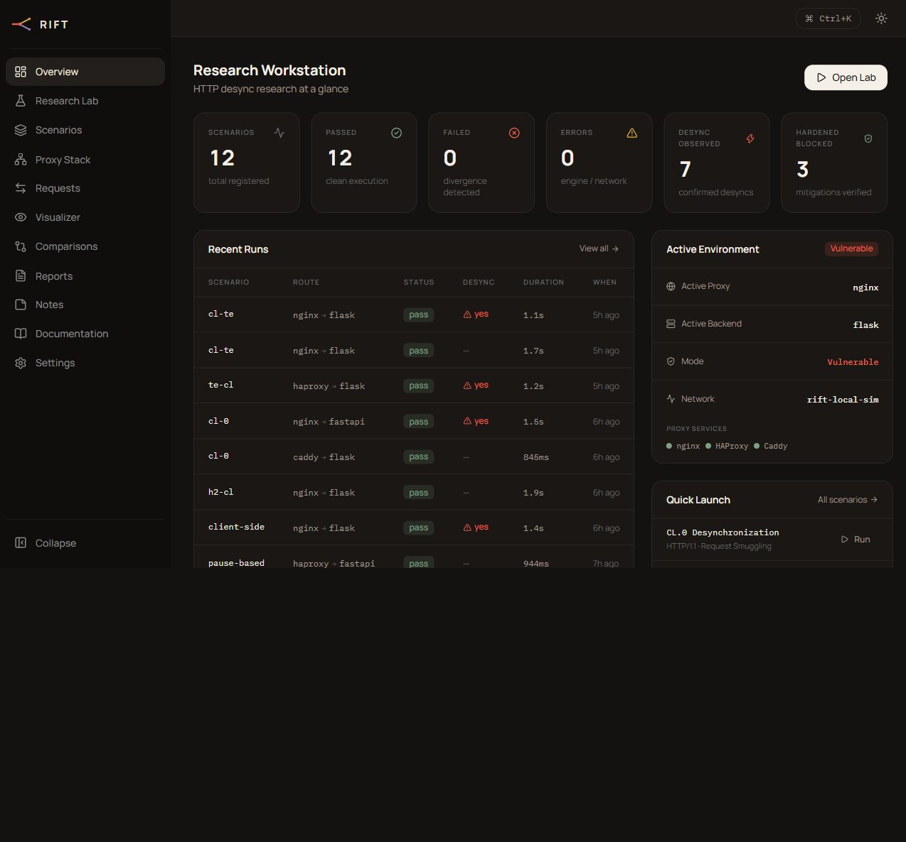
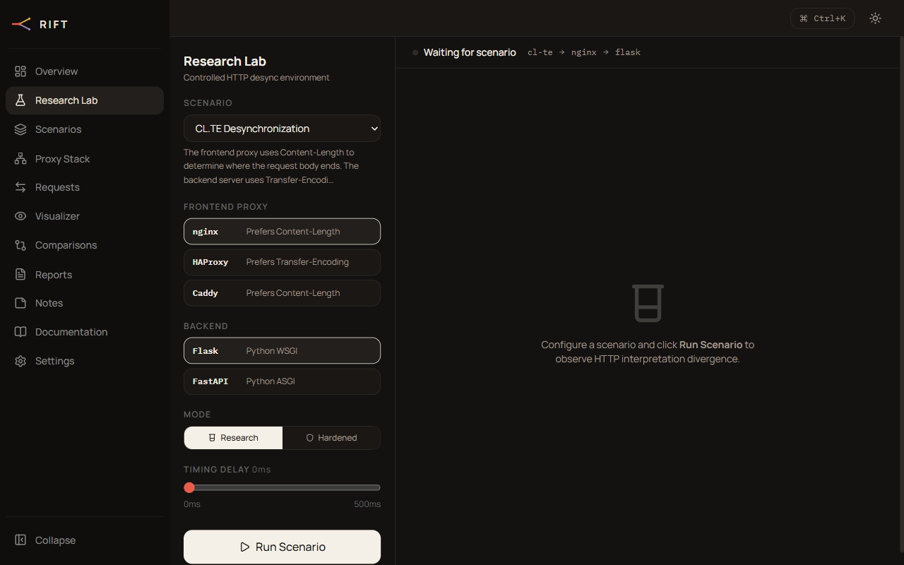
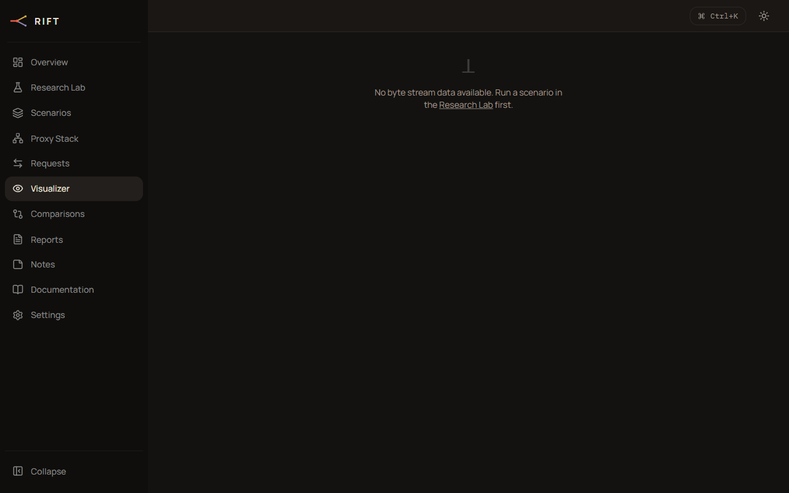
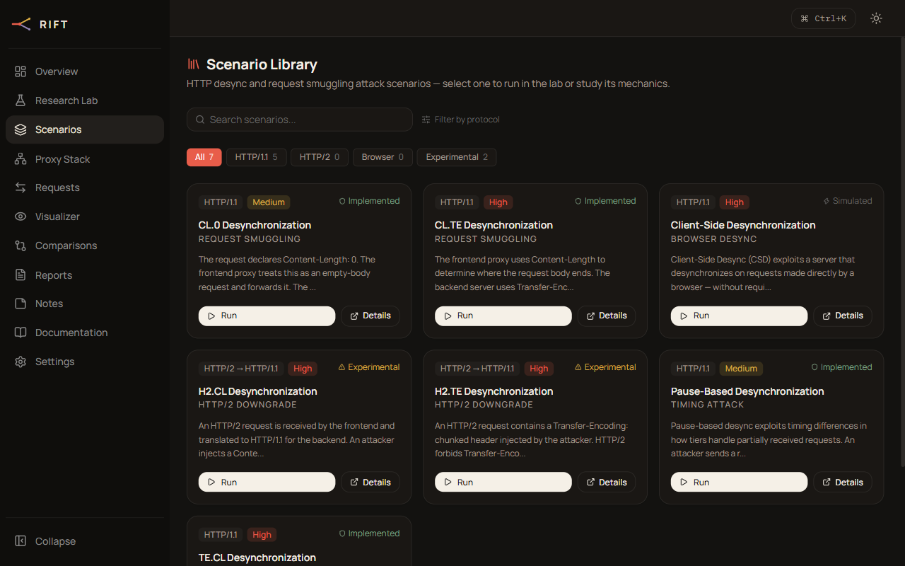
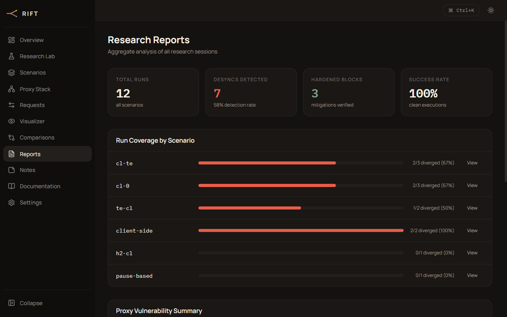
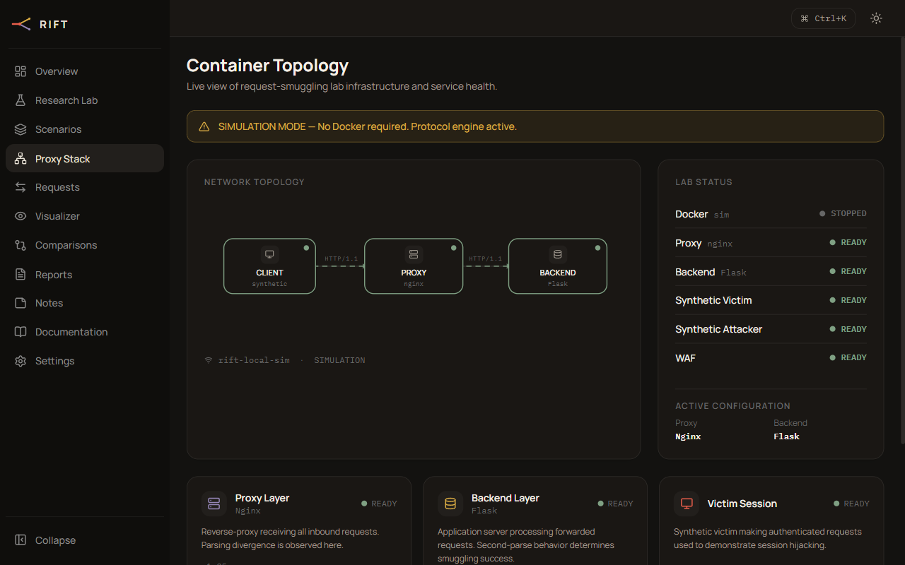
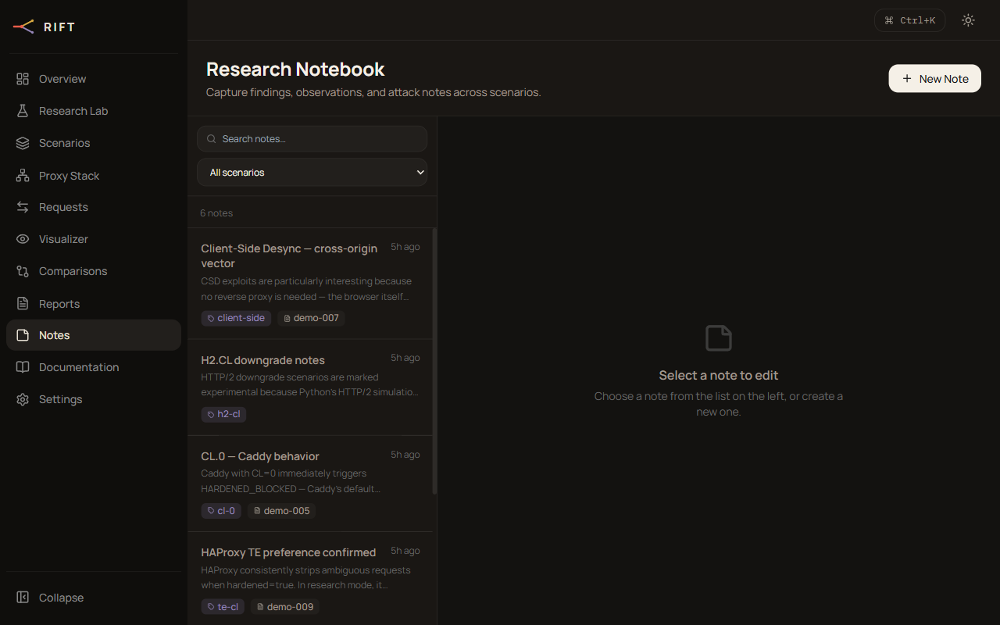

<div align="center">


# RIFT
### HTTP Request Smuggling & Desynchronization Research Platform

[](https://python.org)
[](https://fastapi.tiangolo.com)
[](https://react.dev)
[](https://typescriptlang.org)
[](tests/)
[](LICENSE)

**A local security research workstation for studying HTTP/1.1 and HTTP/2 request desynchronization.**  
Real byte-level protocol engine · Differential analysis · 7 attack scenarios · Hardened mode comparison

---



</div>

---

## Overview

RIFT is a fully local HTTP desynchronization research platform built for **authorized security research and education**. It implements a real HTTP/1.1 protocol parser that computes byte-level framing decisions and performs differential analysis — comparing how a simulated frontend proxy and backend server each interpret the same byte stream.

Every attack demonstration operates against intentionally configured local simulation components with synthetic credentials (`DEMO_` prefix). No external traffic is ever generated.

### What Makes It Real

Unlike dashboard-only tools, RIFT's protocol engine:

- **Parses actual HTTP byte streams** — Content-Length counting, chunked transfer decoding, ambiguous header detection
- **Computes divergence deterministically** — `compare(frontend_interpretation, backend_interpretation)` identifies exact byte offsets where parsing disagrees
- **Extracts smuggled regions** — isolates the bytes a backend sees as a new request that the frontend considered part of the previous one
- **Enforces a security boundary** — the test harness fails closed; only `lab.rift` (synthetic) is ever targeted

---

## Attack Scenarios

| ID | Name | Protocol | Technique | Severity |
|----|------|----------|-----------|----------|
| `cl-te` | CL.TE Desynchronization | HTTP/1.1 | Frontend reads Content-Length; backend reads Transfer-Encoding | **High** |
| `te-cl` | TE.CL Desynchronization | HTTP/1.1 | Frontend reads Transfer-Encoding; backend reads Content-Length | **High** |
| `cl-0` | CL.0 Desynchronization | HTTP/1.1 | Zero Content-Length tricks backend into tunneling body | **Medium** |
| `client-side` | Client-Side Desync | HTTP/1.1 | Browser-initiated desync without a reverse proxy | **High** |
| `pause-based` | Pause-Based Desync | HTTP/1.1 | Timeout differences cause boundary disagreement | **Medium** |
| `h2-cl` | H2.CL Downgrade | HTTP/2 → HTTP/1.1 | Injected Content-Length survives HTTP/2 downgrade | Experimental |
| `h2-te` | H2.TE Downgrade | HTTP/2 → HTTP/1.1 | Injected Transfer-Encoding survives HTTP/2 downgrade | Experimental |

---

## Architecture

```
┌─────────────────────────────────────────────────────────────────┐
│  Browser  ·  React + TypeScript + Vite  ·  localhost:5173       │
│                                                                   │
│  ┌──────────────┐  ┌──────────────┐  ┌──────────────────────┐   │
│  │   Research   │  │  Byte Stream │  │  Scenario Library /  │   │
│  │     Lab      │  │  Visualizer  │  │  Runs / Notes / Docs │   │
│  └──────┬───────┘  └──────┬───────┘  └──────────┬───────────┘   │
│         │   REST + WebSocket         │           │               │
└─────────┼────────────────────────────┼───────────┘               │
          ▼                            ▼
┌─────────────────────────────────────────────────────────────────┐
│  FastAPI  ·  localhost:8000                                      │
│                                                                   │
│  ┌─────────────────────────────────────────────────────────┐    │
│  │  Protocol Engine  (real byte-level parsing)              │    │
│  │  ┌──────────────────┐   ┌─────────────────────────────┐ │    │
│  │  │   framing.py     │   │    differential.py           │ │    │
│  │  │  parse_stream()  │──▶│  compare(fe, be) → result   │ │    │
│  │  │  detect_framing()│   │  extracts smuggled_region    │ │    │
│  │  └──────────────────┘   └─────────────────────────────┘ │    │
│  └─────────────────────────────────────────────────────────┘    │
│                                                                   │
│  ┌─────────────────────────────────────────────────────────┐    │
│  │  Simulation Layer  (no Docker needed)                    │    │
│  │  ProxyProfile(nginx | haproxy | caddy)                   │    │
│  │  BackendProfile(flask | fastapi)                         │    │
│  │  Stream builders per scenario → exact byte sequences     │    │
│  └─────────────────────────────────────────────────────────┘    │
│                                                                   │
│  SQLite (rift.db) — Runs · ResearchNotes · Evidence              │
└─────────────────────────────────────────────────────────────────┘
```

---

## Screenshots

<table>
<tr>
<td width="50%">

**Research Lab** — configure proxy/backend, run any scenario, watch events stream live



</td>
<td width="50%">

**Byte Stream Visualizer** — 4 display modes with byte-semantic highlighting



</td>
</tr>
<tr>
<td width="50%">

**Scenario Library** — 7 attack variants, filter by protocol



</td>
<td width="50%">

**Reports** — aggregate divergence analysis by scenario and proxy



</td>
</tr>
<tr>
<td width="50%">

**Topology** — simulated proxy chain visualizer



</td>
<td width="50%">

**Research Notes** — linked to runs, searchable, markdown-enabled



</td>
</tr>
</table>

---

## Quick Start

### Prerequisites

- Python 3.11+
- Node.js 20+

### 1. Clone

```bash
git clone https://github.com/het-P301204/rift.git
cd rift
```

### 2. Start the API

```bash
cd apps/api
python -m venv venv
venv\Scripts\activate          # Windows
# source venv/bin/activate     # macOS/Linux

pip install -r requirements.txt
uvicorn main:app --reload --port 8000
```

### 3. Start the Frontend

```bash
cd apps/web
npm install
npm run dev
```

Open **http://localhost:5173**

### 4. (Optional) Seed Demo Data

```bash
cd apps/api
python seed_demo.py
```

This populates 12 synthetic runs and 5 research notes — no real requests are ever made.

---

## Project Structure

```
rift/
├── apps/
│   ├── api/                    # FastAPI backend
│   │   ├── main.py             # Routes, WebSocket handler
│   │   ├── protocol/
│   │   │   ├── models.py       # FramingMode, HttpMessage, Interpretation, Divergence
│   │   │   └── framing.py      # Byte-level HTTP parser
│   │   ├── analysis/
│   │   │   └── differential.py # compare(frontend, backend) → DifferentialResult
│   │   ├── simulation/
│   │   │   └── lab.py          # ProxyProfile, BackendProfile, stream builders
│   │   ├── scenarios/
│   │   │   └── loader.py       # YAML fixture loader
│   │   ├── db/
│   │   │   └── models.py       # Run, ResearchNote, Evidence ORM models
│   │   ├── requirements.txt
│   │   └── seed_demo.py        # Demo data seeder
│   └── web/                    # React + TypeScript + Vite frontend
│       └── src/
│           ├── pages/          # 14 pages
│           ├── components/     # Layout, ByteViewer, EventTimeline, ...
│           ├── store/          # Zustand lab store
│           └── lib/api.ts      # Axios client + WebSocket helper
├── fixtures/                   # YAML scenario definitions
│   ├── cl-te/scenario.yaml
│   ├── te-cl/scenario.yaml
│   ├── cl-0/scenario.yaml
│   ├── h2-cl/scenario.yaml
│   ├── h2-te/scenario.yaml
│   ├── client-side/scenario.yaml
│   ├── pause-based/scenario.yaml
│   └── hardened/hardened.yaml
├── tests/
│   └── backend/
│       ├── conftest.py
│       ├── test_framing.py     # 19 protocol engine tests
│       └── test_simulation.py  # 13 simulation tests
├── docs/
│   ├── architecture.md
│   └── threat-model.md
└── scripts/
    └── start.ps1               # PowerShell one-shot launcher
```

---

## How It Works

### The Core Problem

HTTP/1.1 has two ways to delimit a request body:

```http
Content-Length: 13

Hello, world!
```

```http
Transfer-Encoding: chunked

d\r\n
Hello, world!\r\n
0\r\n
\r\n
```

RFC 7230 §3.3.3 says Transfer-Encoding takes priority when both are present — but not every server agrees. When a reverse proxy (frontend) uses one rule and the backend uses another, the same byte stream is interpreted as **different numbers of requests**. This is desynchronization.

### CL.TE Example — Byte Level

```
Attacker sends (147 bytes):

POST /donate HTTP/1.1\r\n
Host: lab.rift\r\n
Content-Length: 136\r\n          ← frontend stops here (reads 136 bytes)
Transfer-Encoding: chunked\r\n
\r\n
0\r\n                             ← backend stops here (terminal chunk)
\r\n
GET /admin HTTP/1.1\r\n          ← backend sees this as a NEW request
Host: lab.rift\r\n               ← 49 bytes smuggled into the next
```

RIFT's engine parses this stream from both the proxy's and backend's perspective and reports:

```json
{
  "severity": "high",
  "frontend_count": 1,
  "backend_count": 2,
  "divergent_byte_offset": 92,
  "smuggled_region_hex": "474554202f61646d696e..."
}
```

### Hardened Mode

Toggle **Hardened** in the lab to apply documented defensive settings (rejecting requests with both CL and TE headers present). The engine emits `HARDENED_BLOCKED` before the stream ever reaches the parsing stage, proving the mitigation works.

---

## API Reference

| Method | Path | Description |
|--------|------|-------------|
| `GET` | `/api/scenarios` | List all scenarios |
| `GET` | `/api/scenarios/{id}` | Single scenario detail |
| `GET` | `/api/runs` | Run history (paginated) |
| `GET` | `/api/runs/{id}` | Run detail with events |
| `DELETE` | `/api/runs` | Clear all run history |
| `GET` | `/api/stats` | Aggregate statistics |
| `GET` | `/api/topology` | Simulated network topology |
| `GET` | `/api/notes` | All research notes |
| `POST` | `/api/notes` | Create a note |
| `PATCH` | `/api/notes/{id}` | Update a note |
| `DELETE` | `/api/notes/{id}` | Delete a note |
| `GET` | `/api/evidence/{run_id}` | Evidence artifacts for a run |
| `GET` | `/api/health` | Health check |
| `WS` | `/ws/run` | Stream scenario execution events |

### WebSocket Protocol

Send a JSON payload to start a run:

```json
{
  "scenario_id": "cl-te",
  "proxy": "nginx",
  "backend": "flask",
  "hardened": false,
  "timing_ms": 0
}
```

Events streamed back:

```
INIT → PROXY_READY → BACKEND_READY → CLIENT_SENT
  → PROXY_PARSED → BACKEND_PARSED → DIVERGENCE → DONE
```

or in hardened mode:

```
INIT → PROXY_READY → HARDENED_BLOCKED → DONE
```

---

## Running Tests

```bash
cd rift
pip install pytest pytest-asyncio
pytest tests/ -v
```

```
tests/backend/test_framing.py::test_detect_cl_framing PASSED
tests/backend/test_framing.py::test_detect_te_framing PASSED
tests/backend/test_framing.py::test_ambiguous_framing_both_headers PASSED
...
tests/backend/test_simulation.py::test_clte_scenario_produces_divergence PASSED
tests/backend/test_simulation.py::test_hardened_mode_blocks_clte PASSED
...
32 passed in 1.43s
```

---

## Security & Scope Boundary

RIFT is designed for **local, authorized research only**.

| ✅ Allowed | ❌ Never Allowed |
|------------|-----------------|
| Local simulation components | External URLs |
| `DEMO_` prefix synthetic credentials | Real credentials |
| Controlled lab environment | Public internet |
| Authorized pentesting research | Production infrastructure |

**Containment guarantees enforced by the codebase:**
- All stream builders target `lab.rift` only — enforced by test `test_only_lab_targets_allowed`
- Victim credentials always use `DEMO_` prefix — enforced by test `test_demo_credentials_are_synthetic`
- `scenario_id` path-traversal protection — resolved paths validated against `FIXTURES_DIR`
- No subprocess calls, no outbound requests, no credential storage

See [`docs/threat-model.md`](docs/threat-model.md) for a full threat analysis.

---

## Tech Stack

| Layer | Technology |
|-------|-----------|
| Frontend | React 19 · TypeScript 5.7 · Vite 8 |
| State | Zustand · @tanstack/react-query |
| Styling | Tailwind CSS v3 · Framer Motion |
| Icons | Lucide React |
| Backend | FastAPI 0.142 · Python 3.11+ |
| Database | SQLite via SQLAlchemy 2 |
| Protocol | Custom byte-level HTTP parser (no external libs) |
| Testing | pytest + pytest-asyncio |

---

## Design System

RIFT uses a graphite-dark base with semantic accent colors:

| Token | Hex | Meaning |
|-------|-----|---------|
| `vermilion` | `#E85D4A` | Divergence / attack |
| `sage` | `#7FA083` | Hardened / safe |
| `golden` | `#D8AA42` | Warning / experimental |
| `iris` | `#9586B8` | Frontend / proxy |
| `plum` | `#4B3A4F` | Backend server |
| `graphite` | `#171717` | Surface / background |

Byte semantic classes: `.byte-header` (iris) · `.byte-body` (golden) · `.byte-chunk-size` (plum) · `.byte-smuggled` (vermilion, left border) · `.byte-trailer`

---

## Contributing

This is a research tool — contributions that add scenarios, improve protocol accuracy, or strengthen the simulation layer are welcome.

1. Fork the repo
2. Run tests: `pytest tests/ -v`
3. Add tests for any new scenario or engine change
4. Open a pull request

---

## References

- [PortSwigger Web Security Academy — HTTP Request Smuggling](https://portswigger.net/web-security/request-smuggling)
- [RFC 7230 — HTTP/1.1 Message Syntax and Routing](https://www.rfc-editor.org/rfc/rfc7230)
- [RFC 9110 — HTTP Semantics](https://www.rfc-editor.org/rfc/rfc9110)
- [HTTP/2 Desync Attacks (James Kettle, 2021)](https://portswigger.net/research/http2)
- [Browser-Powered Desync Attacks (James Kettle, 2022)](https://portswigger.net/research/browser-powered-desync-attacks)

---

<div align="center">

Built for security research and education.  
All demonstrations operate in a controlled local simulation environment.

**[View on GitHub](https://github.com/het-P301204/rift)**

</div>
